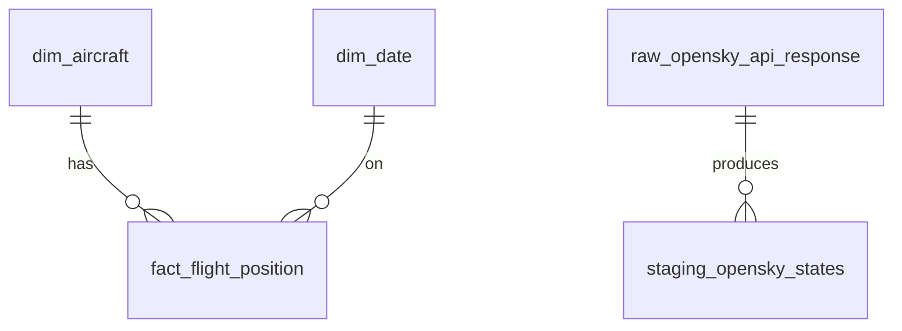

# Flight Data Pipeline

An end-to-end data engineering project built during a data engineering internship. It ingests live air-traffic data from the [OpenSky Network](https://opensky-network.org/) REST API, stages it in PostgreSQL, orchestrates it with Apache Airflow, streams it with Apache Kafka, and visualises it in a BI dashboard.

## Architecture

```
OpenSky API -> (Python extractor) -> raw -> staging -> warehouse (star schema) -> BI dashboard
                                      ^ orchestrated by Airflow; Kafka added in Week 3
```

| Layer | Schema | Purpose |
|---|---|---|
| Raw | `raw` | Full API responses stored untouched (JSONB) |
| Staging | `staging` | One typed row per aircraft state; invalid rows flagged, not deleted |
| Warehouse | `warehouse` | Star schema: `fact_flight_position`, `dim_aircraft`, `dim_date` |



## Project plan

| Phase | Focus | Deliverables |
|---|---|---|
| Week 0 | Tooling setup | VS Code, Git, Postgres, DBeaver, Docker, BI tool |
| Week 1 | ETL foundations (API instead of CSV) | Schema, extractor, SQL cleaning, window functions and CTEs |
| Week 2 | Orchestration | Airflow DAG, idempotent UPSERT, Docker Compose, troubleshooting guide |
| Week 3 | Streaming | Kafka producer/consumer, hourly warehouse loads, first dashboard |
| Week 4 | Scaling | Second source (Open-Meteo weather), data-quality fixes, rate-limit monitoring, second dashboard |

## Setup (Windows / PowerShell)

1. Clone the repo and enter it.
2. Create and activate a virtual environment:
   ```powershell
   python -m venv .venv
   .venv\Scripts\Activate.ps1
   pip install -r requirements.txt
   ```
3. Copy `.env.example` to `.env` and fill in your values.
4. Create the database (edit the password in the file first):
   ```powershell
   psql -U postgres -f sql/00_create_database.sql
   ```
5. Create schemas and tables:
   ```powershell
   $files = "01_schemas","02_raw","03_staging","04_warehouse"
   foreach ($f in $files) { psql -U pipeline_user -d flights_dw -f "sql/$f.sql" }
   ```

## Repository layout

```
sql/        Database DDL, run in numeric order
docs/       Troubleshooting log and design notes
src/        Extraction and loading code (added in Week 1)
dags/       Airflow DAGs (added in Week 2)
```

## Git workflow

All changes go through a feature branch and pull request: `git switch -c feature/<name>` -> commit -> push -> PR -> review -> merge.

## Data quality notes

- OpenSky returns null positions and aircraft on the ground; these are flagged in `staging` with `reject_reason`.
- Dedup key in the warehouse: `(aircraft_key, position_ts)`.

## Data source terms

OpenSky data is subject to its terms of use. Do not commit API credentials.
